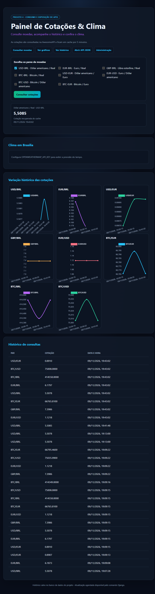
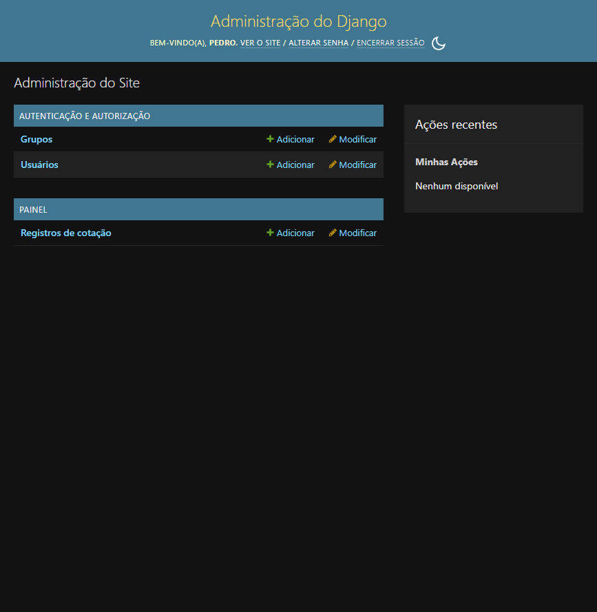

# Painel de Cotações & Clima — Projeto 4

Aplicação Django que consome a AwesomeAPI, guarda cotações no banco local ou
PostgreSQL hospedado, expõe o histórico por uma API REST e desenha sua variação
no navegador. Se a AwesomeAPI limitar as chamadas, o painel usa as taxas
públicas da Coinbase como alternativa. Também pode mostrar o clima atual da
cidade configurada usando a OpenWeatherMap.

## Site publicado

Acesse o [Painel de Cotações & Clima](https://projeto4-1ry2.onrender.com/).
Ele roda na nuvem, sem depender do computador local. No plano gratuito do
Render, o serviço pode suspender após inatividade e levar alguns segundos para
acordar.

## Funcionalidades

- Consulta de vários pares de moedas em uma única requisição:
  USD/BRL, EUR/BRL, GBP/BRL, BTC/BRL, USD/EUR, EUR/USD, BTC/USD e BTC/EUR.
- Fallback para as taxas públicas da Coinbase quando a AwesomeAPI retorna
  limite de requisições HTTP 429.
- Cache em memória das cotações por 5 minutos para evitar chamadas externas
  repetidas; o cache armazena valores por par e por URL de API configurada.
- Persistência das consultas novas usando `DecimalField`.
- Histórico JSON em `/api/historico/`, somente leitura, limitado aos 500
  registros mais recentes.
- Tabela dinâmica e gráficos interativos com Chart.js, atualizados
  automaticamente aproximadamente a cada 60 segundos enquanto a página está
  visível; o intervalo também respeita o cache da AwesomeAPI.
- Clima atual da cidade configurada, com cache de 10 minutos. A chave da
  OpenWeatherMap é opcional; sem ela, o painel informa como habilitar o recurso.
- Comando Django para consultar os pares periodicamente sem depender de uma
  requisição de navegador.
- Django Admin para visualizar os registros.
- Testes automatizados que simulam as APIs e podem ser executados offline.

## Requisitos

- Python 3.10 ou superior.
- Acesso à internet para consultar as APIs e carregar o Chart.js.
- Uma chave gratuita da OpenWeatherMap para habilitar o cartão de clima.

## Como executar no Windows (PowerShell)

```powershell
python -m venv .venv
.\.venv\Scripts\Activate.ps1
python -m pip install -r requirements.txt
python manage.py migrate
python manage.py runserver 127.0.0.1:8005
```

Abra <http://127.0.0.1:8005/>. A tela inicial tem atalhos para consulta,
gráficos, histórico JSON e administração. A aplicação consulta USD/BRL por padrão; marque
um ou mais pares e use **Consultar cotações** para selecionar outros.

Se o PowerShell bloquear a ativação do ambiente virtual, execute
`Set-ExecutionPolicy -Scope Process -ExecutionPolicy Bypass` no terminal atual
e tente ativá-lo novamente.

## Capturas de tela





## Clima e variáveis de ambiente

Crie uma chave no painel da OpenWeatherMap e configure-a no terminal antes de
iniciar o Django. Defina também a cidade (Brasília é o padrão):

```powershell
$env:OPENWEATHERMAP_API_KEY = "sua-chave"
$env:WEATHER_CITY = "Brasília,BR"
python manage.py runserver 127.0.0.1:8005
```

Não publique a chave, não a adicione ao código-fonte e não a envie ao GitHub.
`.env.example` lista as variáveis esperadas, mas não é carregado
automaticamente pelo Django. Configure-as no ambiente que inicia o servidor.

Outras configurações:

- `COTACAO_URL`: endpoint AwesomeAPI compatível com `/last/PAIR`; o padrão
  permite consultar pares múltiplos.
- `DJANGO_SECRET_KEY`: segredo Django; use um valor próprio fora do ambiente
  local.
- `DJANGO_DEBUG`: defina `false` em produção.
- `DJANGO_ALLOWED_HOSTS`: nomes de host permitidos separados por vírgula.

## Rotas

| Rota | Método | Descrição |
| --- | --- | --- |
| `/` ou `/consultar/` | GET | Consulta os pares selecionados e mostra clima, histórico e gráfico |
| `/api/historico/` | GET | Retorna até 500 registros recentes em JSON |
| `/api/cotacoes/tempo-real/` | GET | Atualiza os pares selecionados e devolve seus registros recentes |
| `/health/` | GET | Verificação simples de disponibilidade do serviço |
| `/admin/` | — | Administração dos registros e usuários do Django |

Para criar uma conta de administração, use `python manage.py createsuperuser`.

## Cache

As cotações da página de consulta ficam em cache por 300 segundos, as
atualizações do gráfico por 60 segundos, e o clima por 600 segundos. O cache
padrão do Django é local ao processo; reiniciar o servidor o limpa. O endpoint
de atualização não cria registros duplicados se o valor não mudou. Para trocar
ou desabilitar o cache, configure um backend apropriado em `CACHES`.

A atualização é periódica, não um fluxo instantâneo por WebSocket: o navegador
consulta o servidor aproximadamente a cada minuto, enquanto a resolução e a
frequência dos dados dependem da AwesomeAPI. Para reduzir chamadas, o servidor
compartilha o cache de atualização entre os visitantes.

## Publicação na internet

`127.0.0.1` é um endereço da própria máquina e só pode ser acessado nela.
Desligar o computador encerra o servidor local. Para disponibilizar o site a
outras pessoas mesmo com o computador desligado, publique-o em uma hospedagem
cloud e use um banco remoto persistente. O arquivo `render.yaml` prepara o
deploy do aplicativo no plano gratuito do Render; o banco deve ser criado
separadamente no Neon Free, pois o disco do serviço gratuito do Render não é
persistente.

### Deploy gratuito com Render e Neon

1. Crie uma conta no Neon, crie um projeto PostgreSQL e copie a URL de conexão
   (de preferência a URL com pooler).
2. Crie um repositório público `Projeto4` no GitHub e envie este projeto sem
   incluir `db.sqlite3`, `.env`, chaves ou senhas.
3. No Render, escolha **New > Blueprint**, conecte o repositório e confirme a
   configuração de `render.yaml`.
4. No serviço web do Render, defina `DATABASE_URL` com a URL do Neon. O Render
   gera `DJANGO_SECRET_KEY` automaticamente; `DJANGO_DEBUG` fica desativado.
5. Aguarde o deploy e acesse a URL `onrender.com` fornecida pelo Render. O
   `/health/` é usado para verificar se o serviço responde.

O serviço gratuito do Render pode suspender após inatividade e demorar para
acordar; portanto, não há garantia de disponibilidade ininterrupta. O Neon
Free também pode pausar o banco quando ocioso. O painel atualiza as cotações
quando há visitantes ativos, aproximadamente a cada 60 segundos, limitado à
frequência e disponibilidade da AwesomeAPI. A tarefa agendada no computador
local não roda na hospedagem. O SQLite local e a `OPENWEATHERMAP_API_KEY`
local não são transferidos automaticamente; configure a chave do clima nos
segredos do serviço se desejar habilitar esse recurso. Nunca envie senhas,
URLs privadas de banco ou tokens no chat ou no repositório.

## Consultas agendadas

O comando abaixo consulta os pares disponíveis e salva os valores novos. Ele
pode ser executado manualmente ou agendado pelo sistema operacional:

```powershell
python manage.py consultar_cotacoes
```

No Windows, abra o **Agendador de Tarefas** e crie uma tarefa básica com gatilho
repetido a cada 30 minutos. Configure a ação **Iniciar um programa** assim:

- **Programa/script:** caminho completo para o `python.exe` do ambiente `.venv`,
  por exemplo `C:\caminho\Projeto4\.venv\Scripts\python.exe`.
- **Adicionar argumentos:** `manage.py consultar_cotacoes`
- **Iniciar em:** caminho completo da pasta que contém `manage.py`.

Configure também `COTACAO_URL` na tarefa se estiver usando um endpoint próprio.
No Linux, por exemplo, a mesma tarefa pode ser configurada no cron:

```cron
*/30 * * * * cd /caminho/Projeto4 && /caminho/Projeto4/.venv/bin/python manage.py consultar_cotacoes
```

## Banco de dados e migrations

O SQLite é usado por padrão e o arquivo `db.sqlite3` é criado localmente.
Os valores das cotações suportam até 14 dígitos antes da vírgula e 4 casas
decimais, incluindo moedas de alto valor como BTC. Depois de alterar os models,
gere e aplique migrations:

```powershell
python manage.py makemigrations
python manage.py migrate
```

## Testes

```powershell
python manage.py test
```

Os testes mockam as chamadas externas, portanto não precisam da AwesomeAPI nem
da chave OpenWeatherMap. Cobrem consulta múltipla, cache, erros, API do
histórico, clima e comando agendado.

## Relatório de erros do guia

Baixe o [relatório de erros em PDF](RELATORIO_ERROS_GUIA.pdf) ou consulte a
[versão Markdown](RELATORIO_ERROS_GUIA.md) para ver os limites técnicos
identificados no roteiro, falhas encontradas durante a implementação e as
correções verificadas.

## Publicação e segurança

Não publique o ambiente virtual, o banco local, arquivos `.env` nem chaves de
API. O `SECRET_KEY` padrão serve apenas para desenvolvimento. Em produção,
defina `DJANGO_SECRET_KEY`, configure `DJANGO_DEBUG=false` e informe os hosts
permitidos em `DJANGO_ALLOWED_HOSTS`.
